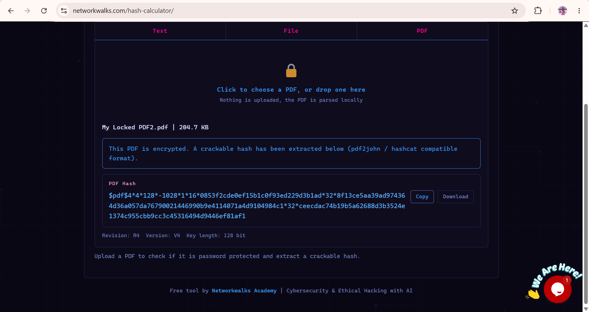
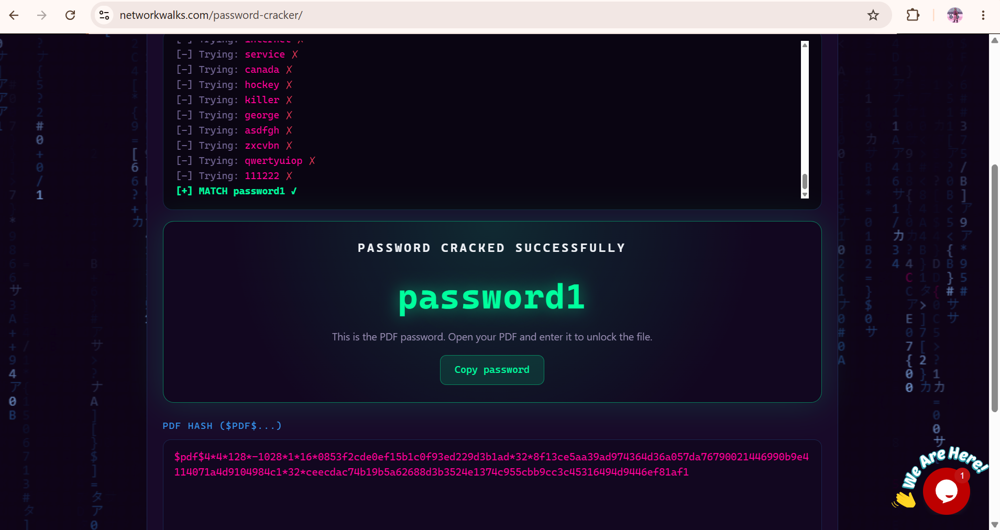
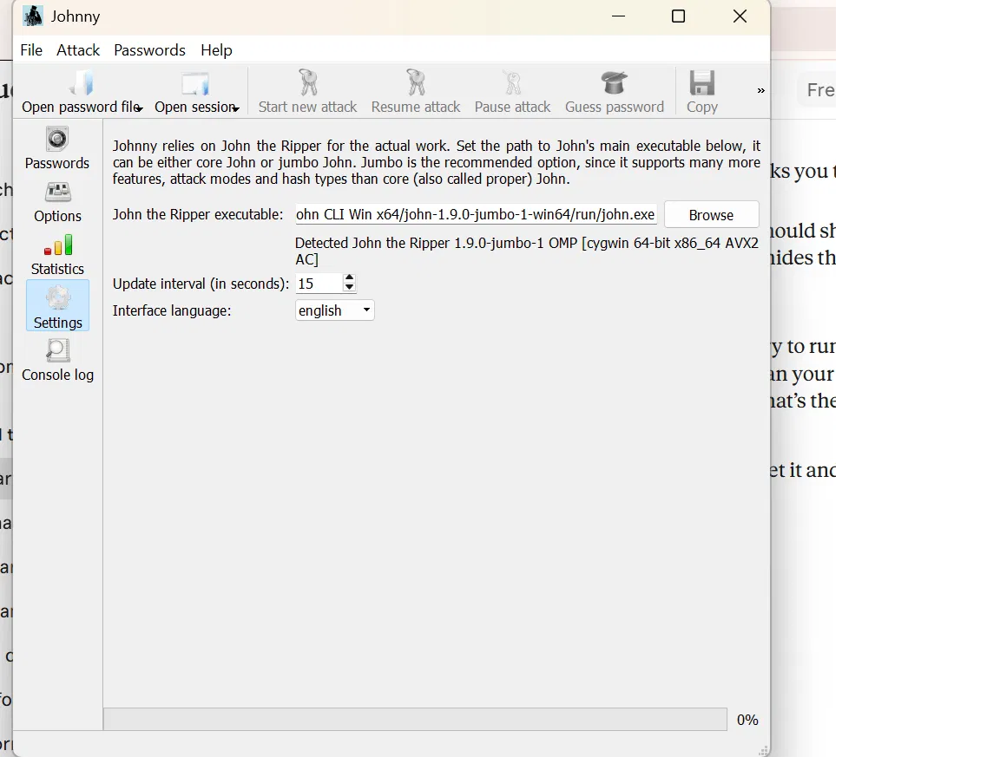
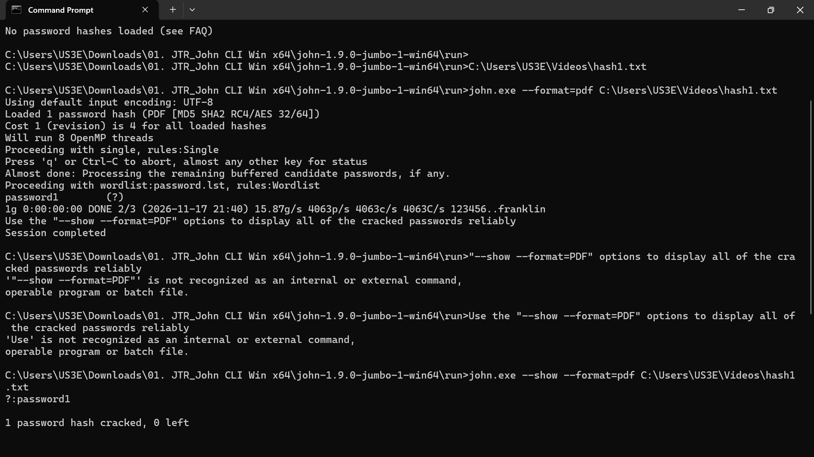

# 🔓 Password Cracking Lab (JTR & NetworkWalks Tools)

**Week 3 — Networkwalks Cybersecurity Internship, Batch B084**


**Author:** Nosiru | **Program:** Networkwalks Cybersecurity Internship, Batch B084 | **Week 3 Project**

---

## 1. Introduction

Week 3 focuses on **password cracking**: recovering a password from a protected file by extracting its hash and testing candidate passwords against it. A locked PDF file (`My Locked PDF1.pdf`) was provided by the program and used throughout both modules.

| Field | Detail |
|---|---|
| Pentester | Nosiru |
| Program / Batch | B084 — Networkwalks Cybersecurity Internship |
| Date | November 2026 |
| Modules completed | W3-PM1 (Password Cracking with JTR), W3-PM2 (Password Cracking with Networkwalks Tools) |

## 2. Background

A password-protected PDF does not store the password itself; it stores a **hash**, a one-way scrambled value derived from the password. Cracking a password means repeatedly guessing candidate passwords, hashing each one the same way, and checking whether the result matches the stored hash. A match reveals the real password.

---

## 3. Module 2 — Password Cracking with Networkwalks Tools (W3-PM2)

### 3.1 Extracting the Hash

The locked PDF was uploaded to the Networkwalks Hash Calculator:

```
https://networkwalks.com/hash-calculator/
```

**Extracted hash:**

```
$pdf$4*4*128*-1028*1*16*0853f2cde0ef15b1c0f93ed229d3b1ad*32*8f13ce5aa39ad974364d36a057da76790021446990b9e4114071a4d9104984c1*32*ceecdac74b19b5a62688d3b3524e1374c955cbb9cc3c45316494d9446ef81af1
```



### 3.2 Cracking the Hash

The hash was pasted into the Networkwalks Password Cracker:

```
https://networkwalks.com/password-cracker/
```

**Result:** `password1`



### 3.3 Verification

The PDF was opened using the password `password1`, confirming the crack was correct.

---

## 4. Module 1 — Password Cracking with JTR (W3-PM1)

### 4.1 Tools Installed

- **John the Ripper (JTR)** — `john-1.9.0-jumbo-1-win64`
- **Johnny** — the graphical front-end for JTR

Johnny was configured to use `john.exe` from the `run` folder of the extracted John the Ripper package. Johnny confirmed the installation:

```
Detected John the Ripper 1.9.0-jumbo-1 OMP [cygwin 64-bit x86_64 AVX2 AC]
```



### 4.2 Preparing the Hash File

The same hash extracted in Module 2 was saved into a plain text file (`hash1.txt`), to be loaded into John the Ripper.

### 4.3 Running the Attack

Rather than relying solely on the Johnny GUI, John the Ripper was run directly from the command line, with the format explicitly specified:

```
cd "C:\Users\US3E\Downloads\01. JTR_John CLI Win x64\john-1.9.0-jumbo-1-win64\run"
john.exe --format=pdf C:\Users\US3E\Videos\hash1.txt
```

**Output:**

```
Loaded 1 password hash (PDF [MD5 SHA2 RC4/AES 32/64])
Cost 1 (revision) is 4 for all loaded hashes
Will run 8 OpenMP threads
Proceeding with single, rules:Single
Proceeding with wordlist:password.lst, rules:Wordlist
password1        (?)
1g 0:00:00:00 DONE
Session completed
```



The password was cracked almost instantly: `password1`.

Confirmed with:

```
john.exe --show --format=pdf C:\Users\US3E\Videos\hash1.txt
```

### 4.4 Verification

The PDF was opened again using `password1`, confirming the independent crack via JTR matched the result from the Networkwalks web tools in Module 2.

---

## 5. Troubleshooting Encountered

**Problem:** Johnny's GUI repeatedly reported `No hashes loaded [format=]`, even though the hash appeared correctly in the Johnny password table. Switching to the command line (`john.exe --format=pdf hash1.txt`) gave a clearer message: `No password hashes loaded (see FAQ)`.

**Root cause:** When the hash was copied from the Hash Calculator website into Notepad, two corruptions were introduced:
1. An extra space was inserted in the middle of the hash (`128 *- 1028` instead of `128*-1028`).
2. A stray closing bracket `]` was appended to the end of the hash.

Since John the Ripper parses a hash as one continuous string split by `*` characters, either error alone was enough to make the entire hash unreadable, with no specific error identifying the exact cause.

**Fix:** The hash was retyped as a single clean line with no extra spaces, line breaks, or stray characters, and re-saved to `hash1.txt`. After this, John the Ripper loaded the hash correctly and cracked it within the same second.

**Lesson:** When copying a long hash from a web page into a text editor, always verify the file's raw contents (for example using `type filename.txt` in Command Prompt) before running a cracking tool against it. A webpage wrapping text visually across several lines does not mean a real line break was introduced, but copy/paste behaviour can sometimes insert one, or other stray characters, invisibly.

## 6. Summary and Key Takeaways

- A hash is not the password itself; it is a one-way fingerprint of it, which cracking tools attack by testing candidate passwords.
- Both a point-and-click web tool and a command-line tool (John the Ripper) recovered the **same password (`password1`)** independently from the same hash, demonstrating that the underlying cracking technique is the same regardless of interface.
- `password1` is a textbook example of a weak password: short, common, and predictable, and it was cracked in well under a second.
- Exact, careful data handling matters in security tooling: a single stray character in a copied hash silently broke the attack with a vague error, underscoring the importance of verifying raw file contents when troubleshooting.

---

*Completed as part of the Networkwalks Cybersecurity Internship (Batch B084), Week 3.*
